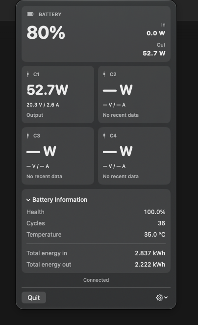
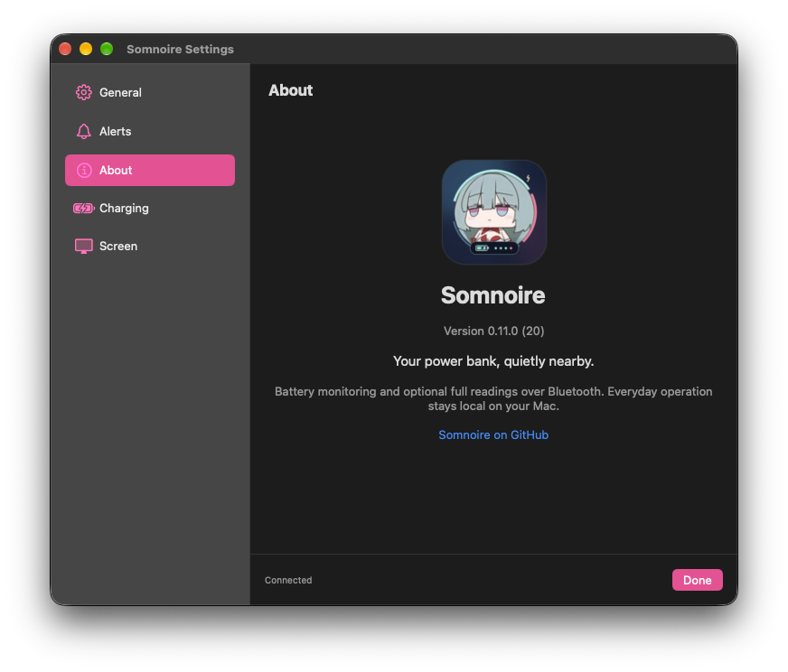

Somnoire is a lightweight, native macOS menu bar app for keeping an eye on supported EcoFlow power banks and managing their settings locally over Bluetooth. check your battery at a glance, peek at the power flowing through each port, then let it settle back into the menu bar.

[downloads](https://github.com/Kusanalee/Somnoire/releases) · [installation guide](docs/installation.md) · [getting started](#getting-started) · [account-id help](docs/first-time-setup.md) · [building](docs/building.md)

> this page describes the current development version. the published **v0.11.0 prerelease** is older: guided onboarding, NouNou, alerts, and recent interface changes are not all included in that download. check the [release notes](https://github.com/Kusanalee/Somnoire/releases/tag/v0.11.0) before installing. **1.0.0 is the planned next release**, not a published download yet.

## a small window into your power bank

  

*an actual dashboard capture, separate from the illustrated banner above. this development-build screenshot predates the removal of the connected label and gear dropdown.*

a look inside settings

*a real development-build capture. the current app places about last in the sidebar and includes a check for updates button.*

## quietly useful

| | a little less checking, a little more knowing |
| :-- | :-- |
| **battery at a glance** | keep the percentage in your menu bar. optional low-battery alerts offer a quiet nudge, with thresholds from 10% to 30%. |
| **follow the flow** | full readings show input and output wattage, four USB-C port cards, and expandable battery health, cycles, temperature, and lifetime energy totals. |
| **make a few adjustments** | change healthy charging, charge limits, discharge reserve, brightness, display duration, and the existing clock’s display options. apply sends edits; revert discards them. |
| **nearby, over Bluetooth** | remember one selected bank. basic percentage monitoring continues while the app runs; the live connection ends when its dashboard and settings close. |
| **your Mac, your preferences** | choose System, Light, or Dark appearance, units, optional launch at login, and up to three percentage decimal places when the bank reports fractions. |

missing power readings stay as dashes. the last verified battery percentage stays visible when stale, dimmed with a last-seen label. opening a panel doesn’t make old data fresh.

## meet NouNou

an optional, Phrolova-inspired little companion for the menu bar. switch between **Default** and **NouNou** in general settings.

| sleepy NouNou | awake NouNou |
| :--: | :--: |
|  |  |
| disconnected, stale, or unavailable | connected / a fresh battery reading |

she follows fresh battery reports, including account-free Bluetooth advertisements—an authenticated connection isn’t needed just to wake her up.

## getting started

the [installation guide](docs/installation.md) covers first launch, macOS permissions, updates, and troubleshooting.

1. grab the app from [GitHub Releases](https://github.com/Kusanalee/Somnoire/releases), unzip it, and move it to Applications. it isn’t Apple-notarized, so macOS may block the first launch; see the release’s instructions before proceeding.
2. open Somnoire, allow Bluetooth access when prompted, and keep your supported bank awake and nearby. the development version’s welcome guide walks through setup; v0.11.0 uses settings → general.
3. choose your bank and the experience you want. close the official EcoFlow app’s Bluetooth connection if it is holding the bank’s connection.

| experience in the development version | account needed? |
| :-- | :-- |
| **battery percentage only** — the default, with nearby battery monitoring and optional alerts | no |
| **full readings** — wattage, battery information, and device settings | one-time setup with the bank’s authorizing EcoFlow account ID |

for full readings, enter **only the numeric account ID**, never your email, password, or login token. an already-linked bank needs its existing authorizing account. after a successful connection, access is remembered in this Mac’s Keychain and the ID is cleared after use.

[the first-time setup guide](docs/first-time-setup.md) covers official-app setup, regional browser ID retrieval, connection handoff, and checking remembered access. the browser procedure is community-documented and varies by region; an ID is only confirmed when the bank accepts it.

use the dashboard’s gear to open settings in the development version. forget bank removes remembered access from this Mac; it does not unbind or reset the bank.

## downloads and compatibility

**[download Somnoire →](https://github.com/Kusanalee/Somnoire/releases)**

- **published release:** [v0.11.0 · prerelease](https://github.com/Kusanalee/Somnoire/releases/tag/v0.11.0), with a universal app ZIP and SHA-256 checksums.
- **Mac:** macOS 13 or later, on Apple silicon or Intel. not every supported macOS version has been tested on hardware.
- **verified bank:** EcoFlow RAPID Pro 27,650 mAh, P512. other models and firmware are unverified.
- **signing:** v0.11.0 is ad-hoc signed, **not Apple-notarized**. the current personal development build uses a reusable local signing certificate; it is also not notarized. neither is a Developer ID release.

current-source features shown here need a source build until a newer release is published. [building instructions](docs/building.md) explain the local signer and build requirements; Xcode with Swift 6 support is required. the maintainer’s signing key is not included.

## a local little companion

Somnoire’s everyday operation stays on your Mac over Bluetooth. there are no analytics or in-app cloud requests, and the app never asks for your EcoFlow password. help and check-for-updates links open your browser; full setup may require the official app and website outside Somnoire.

bank access uses a local, non-synchronizing Keychain credential. preferences and bank selection stay on your Mac. copied diagnostics omit account IDs, credentials, device identities, measurement values, and packet contents; reveal the troubleshooting window by clicking the app icon thirteen times in settings → about.

alerts are opt-in and silent. they need Somnoire running, monitoring enabled, and the bank nearby; monitoring pauses while your Mac sleeps. they don’t require an authenticated connection. the default threshold is 20%, with one notification per low-battery event; a fresh reading five points above the threshold rearms it.

## a few things to know

- percentage monitoring is account-free; account-free **full readings and settings** have not been established for the tested linked bank.
- Somnoire uses the clock artwork already installed on the bank. time setup, artwork changes, sharing, and firmware updates belong in the [official EcoFlow app](https://www.ecoflow.com/us/app-download). automatic local time sync and custom artwork upload are unavailable.
- charging and screen controls have been user-tested, but physical charge/discharge cutoffs have not been independently validated. input-direction behavior and dock readings still have hardware-validation gaps.
- three decimal places is a display preference, not a promise of greater accuracy. advertisements report whole percentages.
- the personal development build retained Bluetooth permission across relaunches and a changed-build upgrade, and displayed the notification artwork on the test Mac. that isn’t a guarantee for every Mac or signing identity.

## under the moonlight, under the hood

Somnoire uses SwiftUI and CoreBluetooth. if you’re curious about how it works:

- [installation and updates](docs/installation.md)
- [build, sign, and test locally](docs/building.md)
- [first-time account-ID setup](docs/first-time-setup.md)
- [Bluetooth reverse-engineering research](docs/BLE-Research.md)
- [P512 protocol implementation and current findings](docs/P512-Protocol.md)
- [telemetry validation history](docs/Phase2E.md) and [earlier validation records](docs/Validation.md)
- [test sources](SomnoireTests/) and [historical development notes](docs/)

protocol research distinguishes decoded data from physical hardware checks. private captures, Android packages, credentials, and build artifacts stay out of the repository.

---

named for Somnoire in *Wuthering Waves*. a small personal project, made for a quieter corner of the menu bar.

independent and unaffiliated with EcoFlow or the creators and publisher of *Wuthering Waves*. Phrolova and game imagery belong to their respective rights holders.

original code is [MIT licensed](LICENSE). dependency licenses and credits are in [third-party notices](ThirdPartyNotices.txt); the code license does not grant rights to third-party characters or artwork.
