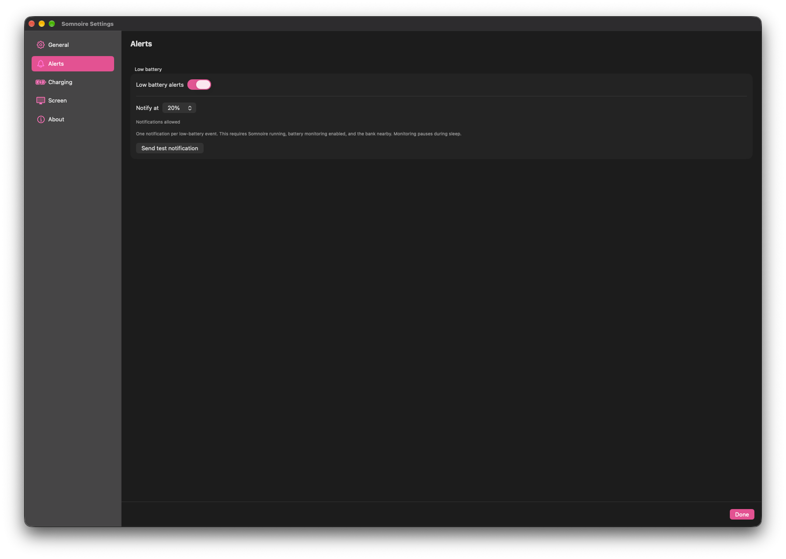
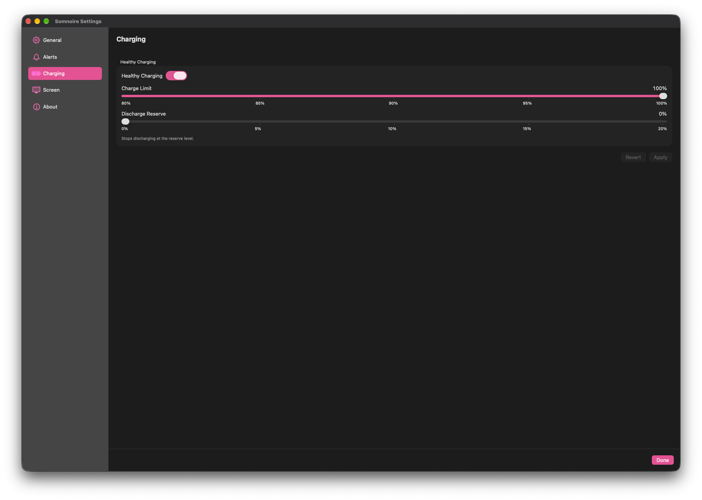
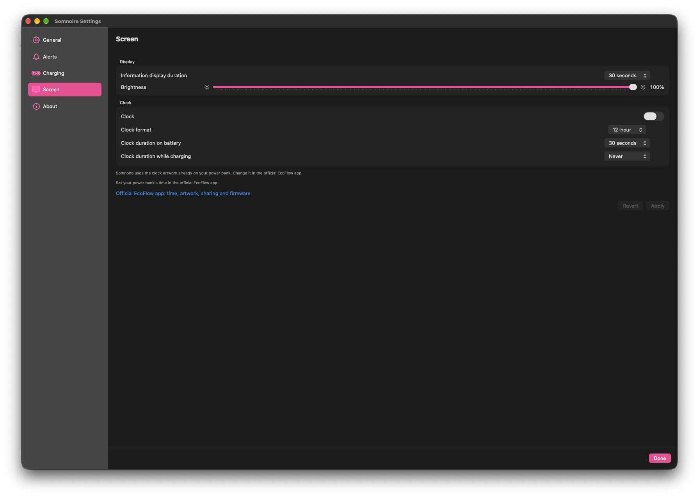
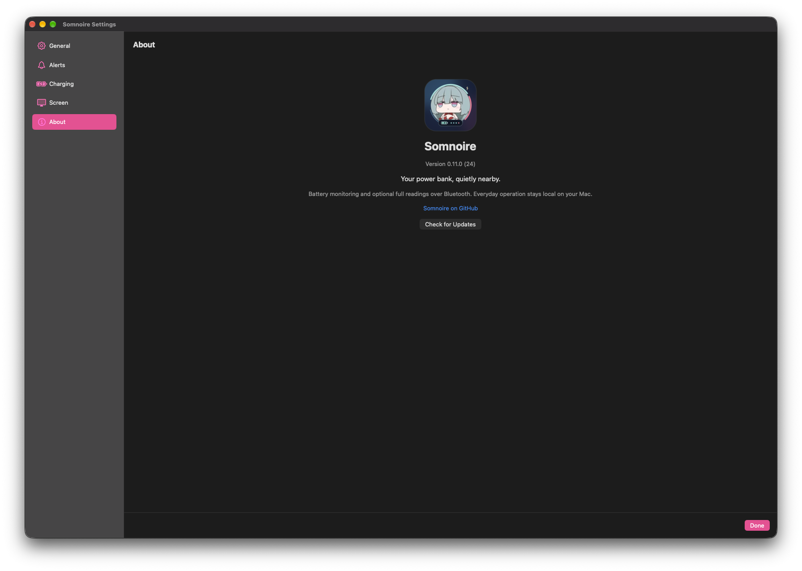

Somnoire is a lightweight, native macOS menu bar app for keeping an eye on supported EcoFlow power banks and managing their settings locally over Bluetooth. tested with the **EcoFlow Rapid Pro 27,650 mAh**, known internally as **P512**. it may work on other models, but they are untested. check your battery at a glance, peek at the power flowing through each port, then let it settle back into the menu bar.

[downloads](https://github.com/Kusanalee/Somnoire/releases) · [installation guide](docs/installation.md) · [getting started](#getting-started) · [account-id help](docs/first-time-setup.md) · [building](docs/building.md)

> **Somnoire 1.0.0 is here.** [download the universal Mac app](https://github.com/Kusanalee/Somnoire/releases/tag/v1.0.0) or follow the [installation guide](docs/installation.md).

## a small window into your power bank

  

*the real dashboard, with live readings and expanded battery information.*

a look inside settings

### general

### alerts

### charging

### screen

### about

## quietly useful

### battery at a glance

- **percentage-only mode:** the default, account-free view keeps your battery in the menu bar without opening a full live connection. Monitor Battery in general settings pauses or resumes nearby monitoring.
- **honest freshness:** the menu bar and dashboard share the same verified percentage. stale readings stay visible but dim, with a last-seen label; unavailable power readings show dashes instead of invented zeroes.
- **your preferred detail:** choose 0, 1, 2, or 3 maximum decimal places. trailing zeroes are trimmed, and whole-number Bluetooth advertisements stay whole. fractions depend on what the bank reports, not an estimate from Somnoire.

### follow the flow

- **input and output totals:** full readings show power entering and leaving the bank, alongside the battery percentage.
- **four USB-C cards:** see each port’s watts, volts, amps, and reported direction. idle and missing data are distinct; see the hardware caveats below for input-direction validation.
- **expandable battery information:** check health, cycles, temperature, and lifetime energy in/out. previously reported details keep their sample ages when disconnected. choose °C or °F and Auto, Wh, or kWh in general settings.

### a gentler charging routine

- **Healthy Charging:** enable the bank’s supported charging-limit mode. turning it off grays out both limit rows, so unavailable edits aren’t offered.
- **charge limit and discharge reserve:** set a charge ceiling from 80% to 100% and a discharge reserve from 0% to 20%, in 5-point steps. charging has been verified to stop at an 80% limit on the tested EcoFlow Rapid Pro 27,650 mAh.
- **apply when you’re ready:** changes stay as drafts until Apply. Revert discards them; confirmed feedback uses the bank’s reported settings, and incomplete confirmation is shown rather than assumed successful.

### the bank’s display, your way

- **display controls:** adjust information-display duration and brightness from your Mac.
- **clock controls:** turn the installed clock on or off, choose 12-hour or 24-hour format, and set separate display durations on battery and while charging.
- **existing artwork:** Somnoire uses the clock artwork already on the bank. time setup, artwork changes, sharing, and firmware updates remain in the official EcoFlow app; local time sync and artwork uploads are unavailable.

### a quiet nudge

- **opt-in low-battery alerts:** off by default, with a 20% starting threshold. choose 10%, 15%, 20%, 25%, or 30% and send a test notification from alerts settings.
- **one alert per event:** notifications are silent. a fresh reading five points above your threshold rearms the alert; stale readings do not trigger it, and changing the percentage display precision does not change alert thresholds.
- **nearby monitoring:** alerts work in both modes without adding an authenticated connection. Somnoire must be running, monitoring enabled, and the bank nearby; monitoring pauses during sleep.

### quietly at home on your Mac

- **native appearance:** choose System, Light, or Dark and keep macOS’s accent color. optional launch at login starts Somnoire with your Mac.
- **one remembered bank:** select your nearby bank in general settings. Somnoire does not silently switch to another one. closing the dashboard and settings ends full-readings access while enabled percentage monitoring continues.
- **optional full readings:** one-time account-ID setup unlocks live telemetry and device settings. access is remembered in local Keychain; returning to percentage-only mode preserves it. Forget removes this Mac’s saved access without unbinding or resetting the bank.
- **a simple dashboard:** Quit and the settings gear keep the panel uncluttered. find monitoring, bank selection, Forget, setup, and Retry in general settings; reopen the welcome guide there anytime.
- **about and updates:** see the app version and open GitHub Releases with Check for Updates. it opens your browser, rather than installing updates automatically. diagnostics remain hidden behind thirteen clicks on the app icon in about.

## meet NouNou

an optional, Phrolova-inspired little companion for the menu bar. switch between **Default** and **NouNou** in general settings.

| sleepy NouNou | awake NouNou |
| :--: | :--: |
|  |  |
| disconnected, stale, or unavailable | connected / a fresh battery reading |

she follows fresh battery reports, including account-free Bluetooth advertisements—an authenticated connection isn’t needed just to wake her up.

## getting started

the [installation guide](docs/installation.md) covers first launch, macOS permissions, updates, and troubleshooting.

1. grab the app from [GitHub Releases](https://github.com/Kusanalee/Somnoire/releases), unzip it, and move it to Applications. it isn’t Apple-notarized, so macOS may block the first launch; see the release’s instructions before proceeding.
2. open Somnoire, allow Bluetooth access when prompted, and keep your supported bank awake and nearby. the welcome guide walks through setup.
3. choose your bank and the experience you want. close the official EcoFlow app’s Bluetooth connection if it is holding the bank’s connection.

| experience | account needed? |
| :-- | :-- |
| **battery percentage only** — the default, with nearby battery monitoring and optional alerts | no |
| **full readings** — wattage, battery information, and device settings | one-time setup with the bank’s authorizing EcoFlow account ID |

for full readings, enter **only the numeric account ID**, never your email, password, or login token. an already-linked bank needs its existing authorizing account. after a successful connection, access is remembered in this Mac’s Keychain and the ID is cleared after use.

[the first-time setup guide](docs/first-time-setup.md) covers official-app setup, regional browser ID retrieval, connection handoff, and checking remembered access. the browser procedure is community-documented and varies by region; an ID is only confirmed when the bank accepts it.

use the dashboard’s gear to open settings. forget bank removes remembered access from this Mac; it does not unbind or reset the bank.

## downloads and compatibility

**[download Somnoire →](https://github.com/Kusanalee/Somnoire/releases)**

- **published release:** [v1.0.0](https://github.com/Kusanalee/Somnoire/releases/tag/v1.0.0), with a universal app ZIP and SHA-256 checksums.
- **Mac:** macOS 13 or later, on Apple silicon or Intel. not every supported macOS version has been tested on hardware.
- **verified bank:** **EcoFlow Rapid Pro 27,650 mAh** (internal model **P512**). it may work on other models, but they are untested; other firmware is also unverified.
- **signing:** v1.0.0 uses a reusable local signing certificate and is **not Apple-notarized**. it is not a Developer ID release; macOS may block its first launch.

### if Apple cannot verify the app

Somnoire is not notarized. **only consider opening a blocked copy if you downloaded it directly from [this repository’s Releases page](https://github.com/Kusanalee/Somnoire/releases) and trust it.** do not use these steps for mirrors or reuploads.

follow the [step-by-step macOS opening guide](docs/installation.md#if-apple-cannot-verify-somnoire): try opening Somnoire, then use **System Settings → Privacy & Security → Open Anyway** for that app and review the confirmation. this is a per-app exception, not notarization or a safety guarantee. do not override malware/damage warnings or disable Gatekeeper globally.

[building instructions](docs/building.md) explain the local signer and build requirements; Xcode with Swift 6 support is required. the maintainer’s signing key is not included.

## a local little companion

Somnoire’s everyday operation stays on your Mac over Bluetooth. there are no analytics or in-app cloud requests, and the app never asks for your EcoFlow password. help and check-for-updates links open your browser; full setup may require the official app and website outside Somnoire.

bank access uses a local, non-synchronizing Keychain credential. preferences and bank selection stay on your Mac. copied diagnostics omit account IDs, credentials, device identities, measurement values, and packet contents; reveal the troubleshooting window by clicking the app icon thirteen times in settings → about.

alerts are opt-in and silent. they need Somnoire running, monitoring enabled, and the bank nearby; monitoring pauses while your Mac sleeps. they don’t require an authenticated connection. the default threshold is 20%, with one notification per low-battery event; a fresh reading five points above the threshold rearms it.

## limitations

- hardware testing covers the EcoFlow Rapid Pro 27,650 mAh (internal model P512). other models may work, but they and other firmware remain untested. not every supported macOS version has been hardware-tested.
- percentage monitoring is account-free; account-free **full readings and settings** have not been established for the tested linked bank.
- Somnoire uses the clock artwork already installed on the bank. time setup, artwork changes, sharing, and firmware updates belong in the [official EcoFlow app](https://www.ecoflow.com/us/app-download). automatic local time sync and custom artwork upload are unavailable.
- the 80% charge cutoff has been verified on the tested bank. other charge-limit values and discharge-reserve cutoffs remain unverified; input-direction behavior and dock readings also have hardware-validation gaps.
- three decimal places is a display preference, not a promise of greater accuracy. advertisements report whole percentages.
- the tested local build retained Bluetooth permission across relaunches and a changed-build upgrade, and displayed the notification artwork on the test Mac. that isn’t a guarantee for every Mac or signing identity.

## under the moonlight, under the hood

Somnoire uses SwiftUI and CoreBluetooth. if you’re curious about how it works:

- [installation and updates](docs/installation.md)
- [build, sign, and test locally](docs/building.md)
- [first-time account-ID setup](docs/first-time-setup.md)
- [Bluetooth reverse-engineering research](docs/BLE-Research.md)
- [P512 protocol implementation and current findings](docs/P512-Protocol.md)
- [telemetry validation history](docs/Phase2E.md) and [earlier validation records](docs/Validation.md)
- [test sources](SomnoireTests/) and [historical development notes](docs/)

protocol research distinguishes decoded data from physical hardware checks. private captures, Android packages, credentials, and build artifacts stay out of the repository.

---

named for Somnoire in *Wuthering Waves*. a small personal project, made for a quieter corner of the menu bar.

independent and unaffiliated with EcoFlow or the creators and publisher of *Wuthering Waves*. Phrolova and game imagery belong to their respective rights holders.

original code is [MIT licensed](LICENSE). dependency licenses and credits are in [third-party notices](ThirdPartyNotices.txt); the code license does not grant rights to third-party characters or artwork.
